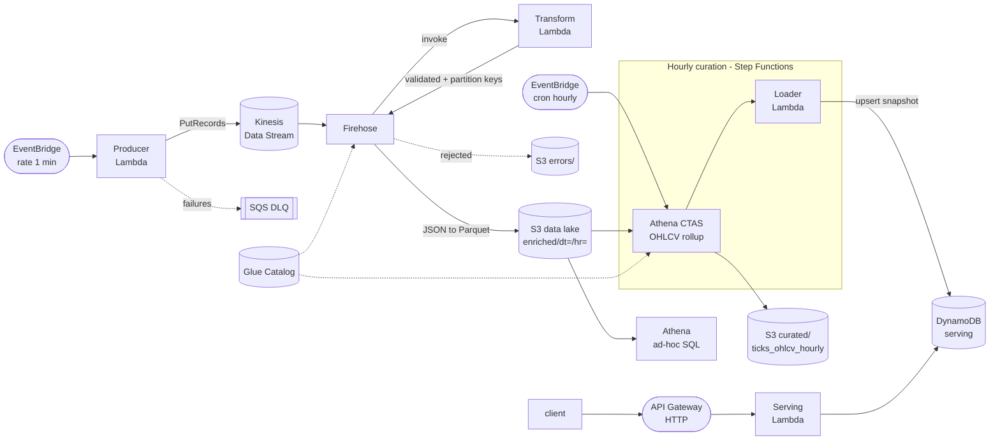

# Sluice

A serverless, near-real-time market-data lakehouse on AWS. Sluice ingests
exchange ticker data every minute, validates and enriches each tick, lands it in
S3 as partitioned Parquet, rolls it up into hourly OHLCV aggregates with Athena,
and serves the latest snapshot through a low-latency HTTP API.

The whole thing is defined in Terraform, tested in CI, and runs comfortably
inside the AWS free tier at the default 3-symbol, 1-minute cadence.



## Why it is built this way

- **Kinesis then Firehose, not Firehose alone.** The raw stream is a reusable
  tap: a second consumer (real-time alerting, an anomaly detector) can attach
  without touching the delivery path.
- **Transformation in Firehose, not a separate consumer.** Validation and
  enrichment happen in the delivery Lambda, and the same call emits the `dt`/`hr`
  partition keys Firehose uses for dynamic partitioning. Bad records are returned
  as `ProcessingFailed` and Firehose routes them to `errors/`, so nothing is
  dropped silently.
- **Partition projection, no crawler.** The Glue table declares projected
  `dt`/`hr` partitions, so Athena resolves partitions from the query predicate.
  That removes crawler cost and the crawler-lag failure mode entirely.
- **Batch-to-serving split.** Athena does the heavy aggregation on a schedule;
  the API only ever does a single-digit-millisecond DynamoDB lookup. Query cost
  and request latency are decoupled.
- **One schema, one source of truth.** `src/common/models.py` defines the record
  shape, the Glue columns, and the DynamoDB item. Code and infrastructure cannot
  drift apart.

## Repository layout

```
infra/            Terraform: root config + 5 modules
  modules/catalog     Glue database, tables (partition projection), Athena workgroup
  modules/ingestion   Kinesis stream, producer Lambda, EventBridge, SQS DLQ, alarm
  modules/delivery    Firehose (Parquet + dynamic partitioning), transform Lambda
  modules/curation    Step Functions workflow, Athena rollup, loader Lambda
  modules/serving     DynamoDB, serving Lambda, HTTP API Gateway
src/              Lambda source
  common/             Shared config, models/validation, structured logging (layer)
  producer/           Scrape exchange -> Kinesis
  transform/          Firehose processor: validate, enrich, partition
  loader/             Athena snapshot -> DynamoDB
  serving/            Read API over DynamoDB
sql/              Readable DDL + the OHLCV aggregation query
tests/            Unit tests (pytest, mocked AWS)
scripts/          Layer packaging, smoke test, manual end-to-end trigger
.github/          CI: pytest + terraform fmt/validate
```

## Getting started

Prerequisites: an AWS account, credentials configured, Terraform >= 1.6,
Python 3.12.

```bash
make install                       # dev dependencies
make test                          # unit tests, no AWS needed
cp infra/terraform.tfvars.example infra/terraform.tfvars
make apply                         # stages the layer, then terraform apply
```

Drive one cycle without waiting for the schedules, then hit the API:

```bash
make trigger                       # invoke producer a few times, run curation
make smoke                         # curl /health, /products, /products/{id}
```

Ad-hoc analysis against the raw lake, straight from the Athena console:

```sql
SELECT product_id, avg(spread_bps) AS avg_spread, count(*) AS ticks
FROM sluice_dev.ticks_enriched
WHERE dt = current_date
GROUP BY product_id
ORDER BY avg_spread DESC;
```

## API

| Method | Path                     | Returns                                  |
|--------|--------------------------|------------------------------------------|
| GET    | `/health`                | liveness                                 |
| GET    | `/products`              | products that have a current snapshot    |
| GET    | `/products/{product_id}` | latest hourly OHLCV snapshot for a symbol |

## Cost and scale notes

At the default cadence (3 symbols, 1-minute producer, hourly curation) the
provisioned pieces are one Kinesis shard and PAY_PER_REQUEST DynamoDB; everything
else is per-invocation. Athena scans only the current day's partition thanks to
projection, so query cost stays flat as history grows. Scaling to hundreds of
symbols means raising `kinesis_shard_count`, widening the producer batch, and
moving `/products` off a scan onto a GSI. See `docs/ARCHITECTURE.md` for the
failure modes each component is designed around.

## Tests and CI

`make test` runs the suite with AWS clients mocked, covering the enrichment math,
the crossed-book / stale / non-numeric validation paths, the Firehose
ok/failed branching, producer DLQ routing, and API route dispatch. CI additionally
runs `terraform fmt -check` and `terraform validate`.
